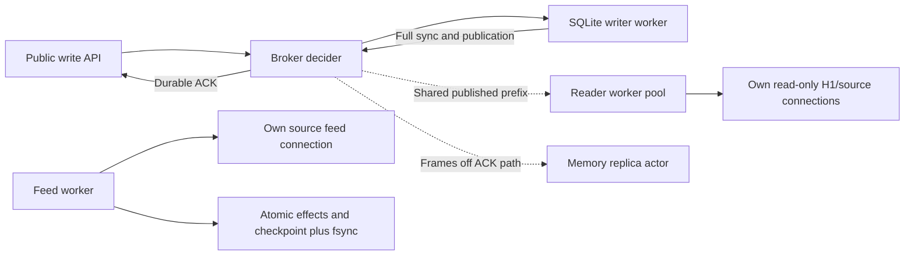

# EXP-P2B round 3: isolate the decider and preserve durable publication

North star: P2 offer-to-ACK latency under P1's exact pinned reads, with P3 ordered
resume and an atomic durable consumer. Authority: `lab/SCOPE.md`,
`lab/NORTH-STAR.md`, `lab/TARGETS.md`; design and rejected alternatives: [R42](../../research/R42-p2-broker-latency.md).

## Result

<!-- R3-RESULT-START -->

**Implementation complete; 81 matched cells accounted for 243,000 commits, 24,117,588 concurrent content checks and 243,000 post-load pin checks.** Every valid comparison cell completed 1,000 samples per facts band with unchanged source/build inputs and no recorded semantic/timeline errors. The sweep selected **8 workers**.

The final 256-reader 10-fact p50/p99 results were **13.80/92.88 ms, 11.34/100.52 ms, 8.92/81.62 ms** across the three repeats. Twenty-fact results were **14.36/93.60 ms, 11.49/84.49 ms, 9.85/68.25 ms**. These are the complete repeated observations; no favorable rerun replaces them. **The repeated final small-band diagnostic does not consistently meet the provisional 10/50 ms bars.**

Reader placement, indexed worker-local source reads and asynchronous main-thread RPCs are delivered. Host/device tail variability remains visible in the separate full-sync and non-commit intervals below. No source-durability tradeoff was adopted.

<!-- R3-RESULT-END -->

This is builder execution evidence for an offline composition, not independent
acceptance, a live XTDB result or a contract promotion. No engine, Docker
lifecycle operation, slot, deployment, merge, push or acceptance edit was made.

## Interpretation and remaining bottlenecks

At 256 readers, mean root-thread CPU fell from **54.61 s** in the main-feed
baseline to **18.67 s** in the final candidate. Median repeated durable-to-host
p99 fell from **57.04 ms** to **13.33 ms**; final main-thread read RPCs were zero.
The feed-only level reduced median repeated ten-fact ACK p99 from **244.28 ms**
to **88.81 ms**, but its individual repeats were 88.81/295.23/46.44 ms. Moving
source work to one saturated actor did not solve the tail: its median repeated
ACK p99 was 349.62 ms, compared with 96.17 ms for the selected eight-worker H1
pool. These are sequential, noncontemporaneous host windows, not a randomized
causal speedup estimate. The one-worker H1 controls also isolate the source-route
strategy change from pool scaling.

Matched maintenance changed median repeated scheduling/queue/ACK-return p99
from **34.87/33.26/9.38 ms** to **14.90/15.49/1.42 ms**. The final requirement
adds a native startup capability check; FULL/fullfsync was already enabled in
the controls, and startup lies outside the offered trace. Differences between
that final matrix and async maintenance do not establish a faster flush mode.

The final unique-frame COMMIT/full-fsync p99 at 256 readers was
**19.97/17.55/9.75 ms**, versus ACK p99 **92.88/100.52/81.62 ms**. Actual tail
joins show both expensive COMMITs and much larger intervals elsewhere: repeat 1
sequence 1275 spent 94.91 of 145.20 ms in COMMIT, near 100% host busy; repeat 3
sequence 2538 spent 16.04 of 289.04 ms there, near 87.04% host busy and 98.03
MB/s disk traffic. All final loaded runs reached whole-host p95 busy of 100%.
The pool itself consumed substantial CPU, alongside the other recorded processes.
Host coincidence cannot apportion responsibility between this workload, other
agents, scheduling and device behavior. Further placement/CPU-budget experiments
need a controlled host window before a live P2 claim.

The **64 MiB diagnostic WAL alarm was exceeded**: final observed peak was
**116.72 MiB**, with a maximum source snapshot of **193.72 ms**. Snapshot lifetime
includes descheduling; busy_timeout remains zero. The observed short-transaction
implementation therefore supplies no long-run WAL bound. Mean repeated final
replica-visible p99 was **10.67 s** in the growing memory-map replica actor,
although H1/source pinned reads and the independent broker feed stayed correct.
That offline actor result cannot establish live XTDB replica timeliness. Final
feed durable-consumer p99 averaged **31.11 ms** across the loaded repeats; this is
a different interval from ACK and supplies no unmeasured P3 acceptance arm.

## Ordered implementation

1. **Feed isolation.** A dedicated worker owns both polling and
   `FeedConsumerStore.recordEffects`. It still records affected subjects and the
   checkpoint in one write and fsyncs it. Page results return to the driver after
   the offer window; consumer fsync never runs on the decider in this topology.
2. **Worker-local source.** `BrokerReadService` opens a read-only, query-only
   SQLite connection with `busy_timeout=0`. Each request owns a short transaction
   containing the marker and selected indexed rows. Repository overlay and
   source reads no longer make per-read requests to the broker's main thread.
   A shared, double-buffered atomic watermark carries the published epoch,
   frame prefix, position and decision stamp. A generation switch publishes a
   complete slot; readers can retain the prior complete slot while the broker
   prepares the next one. File path/device/inode binding, epoch and prefix checks
   reject the wrong source or a restarted source. Close/abandon invalidates the
   old shared watermark. No read transaction spans a sweep, and no read waits on
   the writer connection. Future bases refuse immediately; old H1 cuts fall
   back to the complete persisted source when retirement makes H1 ineligible.
3. **Reader pool.** The 1/2/4/8-worker sweep uses the permitted SQLite H1 reader
   arm. Each worker has its own read-only connection; subjects and their expected
   pin catalogs are sharded consistently. The memory replica/applier has its own
   actor, so reader scans cannot starve it. This changes the offline reader arm
   from memory-replica-plus-overlay to indexed H1/source; the one-worker H1 sweep
   cell separates that change from the benefit of adding workers. It does not
   measure a live XTDB reader or supply a production reader-hosting service.
4. **Async RPCs.** Pin acquisition, release and purge return promises. Normal
   `LogFeed.poll` and `watermark` are asynchronous; explicit `pollSync` and
   `watermarkSync` remain for forensic/replay tools. `pollAsync` remains an alias.
   Decision lookups and publication also yield: otherwise a synchronous lookup
   or publication could wait behind an asynchronous maintenance write on the
   same connection. Source predicates, single-decider serialization, staged
   subject/claim checks and durable-before-ACK ordering remain intact.
5. **Full sync by default.** Only explicit boolean `false` disables the startup
   capability requirement for diagnostics. Both engine factories set it true.
   WAL `synchronous=FULL`, `fullfsync=ON` and `checkpoint_fullfsync=ON` remain
   unchanged. Startup invokes the actual `F_FULLFSYNC` operation against the DB
   file, checks process success and matches the returned device/inode to that
   exact file. Missing support, interpreter failure or an invalid proof is a
   typed `FullFsyncUnavailable` before a stream/ACK is published. Calibration
   remains a measurement, not evidence that a volume supports the primitive.

The native capability bridge uses `/usr/bin/python3 -I` and its standard `fcntl`
module on this Mac. This is an explicit runtime dependency for the experimental
broker. Default startup refuses on non-darwin hosts; a separately qualified
Linux durability profile is not supplied here. The probe establishes kernel/API
support on the actual file, not drive honesty or survival of a physical power
loss. No power-loss qualification or real unsupported filesystem mount was run.
The negative tests use `/dev/null` and an injected unsupported-probe response at
startup; they are identified as such.

The final offline topology is:

## P3 defect found while repeating

The first worker-local-source matrix stopped on a negative feed-clock check:
frame LSN 2112 was **−0.674708 ms** relative to the writer's recorded durability
return, with no missing frame-clock joins.
SQLite's SQL marker was visible to a reader before the writer sampled its
post-COMMIT durability-return timestamp. The old feed treated that SQL marker
as publication authority. A busy host made this race observable.

The feed now reads the broker's **post-flush publication witness**. It checks
its length/CRC, epoch and frame CRC against the actual source, and checks the
published position against the commit payload's positions. It tolerates an
empty administrative group without inventing a transaction position. Frame
chain and payload CRC validation still runs independently when reading pages.
The witness is an eligibility gate, not a replacement source of durability or
truth. Recovery reconstructs publication from the SQLite log. Its unsynced
sidecar can trail after a power failure; no claim depends on the sidecar
independently surviving power loss.

A controlled test holds publication after append and proves the feed withholds
the commit until publication. It also rejects corrupt witness bytes and a
recomputed-CRC witness with the wrong position. The guarded comparison profiles
all include this fix. Earlier exploratory measurements remain separate evidence;
they are not silently adopted as P3 acceptance.

A later synchronous-maintenance repeat exposed a different race: a reader had
already established an SQL snapshot when it read a newly advanced publication
witness. The guard correctly rejected that inconsistent pair, and the matrix
stopped (`r3-step4-sync-40-worker-64-523d1657-ab5a-4852-9bee-c9d4d3117ce3`).
The corrected reader obtains witness bytes **before** beginning its SQL snapshot,
so the snapshot necessarily covers the witnessed committed prefix. A deterministic
filesystem-read barrier test publishes a new frame at that boundary and verifies
the following snapshot sees it. All nine maintenance-control cells were restarted
from the corrected source; the failed batch and its positive cells remain separate.
Earlier baseline/feed/source/pool cells had no such refusals and are retained as
their original successful observations, rather than described as new executions.
The final corrected snapshot has a new name, `step5-fullsync-corrected-40`;
previous frozen snapshots were retained.

## Measurement method

All cells are offline, one Node process with worker threads, using one
`process.hrtime.bigint()` time domain. Each cell offers 3,000 public
`Triples.transact` commands open-loop at **40 offers/s**, with exactly **1,000
samples each at 10, 20 and 40 facts**. Each reader count is repeated three times.
The first 100-offer/s setup was retained and rejected as an unsuitable load for
the saturated single memory actor; its catch-up deadline failed. The matched
baseline and ordered comparisons use 40 throughout.

The balanced three-band trace raises all denominators. It is a diagnostic,
not TARGETS' frozen writer mix/rate, year-one population or complete P1 workload.
The workload revisits 128 subjects and adds fresh attributes, so historical pins
must mask later writes to the same subject. Every concurrent answer is compared
with its driver-owned expected pin; every receipt also gets a post-load pin
check. In the worker-local profiles, the post-load audit uses indexed source
reads plus periodic memory-replica checks to avoid making full-map audit cost
the measurement's limiting factor. All post-load work lies outside ACK latency.

The matched baseline keeps the consumer on the broker thread. Step 1 changes
only feed placement. Step 2 moves source work to the reader actor. The H1 sweep
then varies pool count at 64 and 256 readers, with three repeats of each count;
the chosen pool also receives three zero-reader baselines. Step 4 includes a
matched synchronous-maintenance control and async maintenance: pin/purge/release
loops run with the same 113 ms pause and no changes to offered writes. Step 5
keeps that maintenance stream and changes the full-sync startup requirement.
The pool rule was declared in code before the sweep: highest mean
correctness-checked goodput at 256 readers among four/eight workers; read p99
breaks ties. This ranks an offline diagnostic, not P1 eligibility.

Source/build copies for each level are frozen in the durable `snapshots/`
directory. Each child hashes and retains its actual source/build preimages,
trace, lockfile, package manifest and native SQLite binary identity; it checks
source stability after execution. The actual outer controller bytes are retained
separately in `controller-preimages-attempt1/` and UUID-named continuation
controller directories with their identity JSON, because
unused controller files copied inside a historical child snapshot are not the
outer controller that launched it. Historical levels intentionally differ from
HEAD; their executed bytes, not relabeled current code, define the comparison.
After the matrix, an unused controller local was removed; the recorded executing
controller remains authoritative. Historical SQL01 callers were migrated to await
pins/releases and explicit synchronous replay polling, and the QLever compatibility
factory now states its existing effective full-sync default explicitly. These
post-measurement changes do not alter the measured memory-broker implementation.

### Stage and CPU interpretation

The driver reports scheduling delay, public staging, queue wait,
validation/encoding, append dispatch, SQLite transaction body,
**COMMIT/full-fsync envelope**, durable-return delivery, source publication and
ACK return. The envelope is the interval between transaction-body completion
and the native transaction's return, not an isolated fsync syscall measurement.
Scheduling delay is included in scheduled-offer-to-ACK. Per-sample stage sums
must equal ACK latency; stage quantiles do not add.

Replica apply is separately measured and remains off the ACK path. Thread CPU
is recorded at command-stage boundaries and inside SQLite/replica/read/check/
feed work. Async stage CPU envelopes include overlapping work and are not
additive attribution. In the async-decider profiles, preparation/publication
CPU counters are also envelopes across awaits. Process totals include all
workers. Root/process CPU runs from offer start through worker shutdown and replica
drain, before the post-load pin audit. Reader/replica/feed counters are snapshots
at their stop replies, so a final apply after that snapshot is outside those
CPU totals. The trace itself spans about 75 seconds. Pooled read percentiles use a 0.1 ms histogram upper bound; single-actor
profiles retain exact sample quantiles. Goodput counts content-checked reads.
WAL peak and maximum short-snapshot duration are retained per source worker;
64 MiB is the diagnostic WAL alarm threshold, not a proven long-run bound.

### Host load and attribution

A separate sampler records host CPU busy fraction, load average, free memory,
`iostat` output and CPU-heavy process names/PIDs alongside each run. Samples use
the same monotonic clock. The first sandboxed setup could not list processes;
the ordered runs use read-only host probes with sandbox escalation. Host busy
percent and disk rates near a tail sample establish coincidence, not causation.
Both our setup/gates and other agents' work can contribute to host load.

<!-- R3-TABLES-START -->

## Complete matched observations

Every row has 1,000 samples **per** facts band. Entries are p50/p99 milliseconds. The COMMIT column is the **unique source-frame** envelope p99, avoiding double counting grouped members.

| Profile             | Repeat | Readers | Workers |     10 facts |     20 facts |     40 facts | COMMIT/full p99 |
| ------------------- | -----: | ------: | ------: | -----------: | -----------: | -----------: | --------------: |
| Baseline, main feed |      1 |       0 |       1 |   7.16/83.09 |   7.88/68.93 |   8.50/83.38 |           12.02 |
| Baseline, main feed |      1 |      64 |       1 |   8.45/85.72 |   8.76/85.56 |  10.08/79.68 |           12.68 |
| Baseline, main feed |      1 |     256 |       1 |  7.35/179.65 |  7.47/174.45 |  8.43/179.72 |           18.25 |
| Baseline, main feed |      2 |       0 |       1 |   6.81/65.14 |   7.13/60.81 |   8.06/78.35 |           10.99 |
| Baseline, main feed |      2 |      64 |       1 |   6.64/89.50 |   6.94/90.25 |   7.86/86.60 |           13.30 |
| Baseline, main feed |      2 |     256 |       1 | 10.86/244.28 | 10.90/245.03 | 12.20/232.78 |           15.90 |
| Baseline, main feed |      3 |       0 |       1 |   6.06/46.02 |   6.82/37.33 |   7.71/46.09 |           12.23 |
| Baseline, main feed |      3 |      64 |       1 | 10.56/334.89 | 11.00/316.64 | 11.75/313.79 |           49.68 |
| Baseline, main feed |      3 |     256 |       1 | 10.10/393.65 | 10.57/420.67 | 11.14/413.90 |           36.37 |
| Feed worker         |      1 |       0 |       1 |   6.55/22.58 |   7.34/16.23 |   7.65/21.38 |            9.20 |
| Feed worker         |      1 |      64 |       1 |  7.02/160.74 |  7.26/179.91 |  8.05/175.12 |           25.34 |
| Feed worker         |      1 |     256 |       1 |   9.20/88.81 |   9.81/99.32 |  10.50/94.73 |           15.68 |
| Feed worker         |      2 |       0 |       1 |  9.03/113.72 |  9.37/113.78 | 10.66/104.50 |           33.40 |
| Feed worker         |      2 |      64 |       1 |   9.40/86.88 | 10.20/100.00 |  11.68/89.81 |           23.74 |
| Feed worker         |      2 |     256 |       1 | 14.01/295.23 | 14.99/284.36 | 16.26/264.85 |           37.55 |
| Feed worker         |      3 |       0 |       1 |   6.80/43.32 |   7.00/37.82 |   8.09/44.07 |           14.62 |
| Feed worker         |      3 |      64 |       1 |   7.33/39.91 |   7.71/34.10 |   8.70/35.83 |            9.62 |
| Feed worker         |      3 |     256 |       1 |   7.06/46.44 |   7.78/50.55 |   8.64/44.45 |           10.25 |
| Local source worker |      1 |       0 |       1 | 10.72/175.62 | 11.61/172.94 | 13.11/188.75 |           31.84 |
| Local source worker |      1 |      64 |       1 |  9.67/115.03 |  10.71/99.63 | 12.01/118.81 |           33.21 |
| Local source worker |      1 |     256 |       1 | 12.98/349.62 | 12.67/326.14 | 15.19/332.00 |           43.22 |
| Local source worker |      2 |       0 |       1 |  8.88/123.70 |  9.51/121.41 | 10.86/107.48 |           19.53 |
| Local source worker |      2 |      64 |       1 | 10.40/399.32 | 10.71/388.81 | 11.65/409.76 |           35.21 |
| Local source worker |      2 |     256 |       1 |  7.70/197.20 |  8.51/185.44 |  9.52/182.60 |           23.73 |
| Local source worker |      3 |       0 |       1 | 10.03/170.05 | 10.71/173.56 | 12.30/176.45 |           46.95 |
| Local source worker |      3 |      64 |       1 | 20.16/285.42 | 19.68/294.59 | 21.62/292.00 |           64.60 |
| Local source worker |      3 |     256 |       1 | 28.84/638.16 | 27.89/648.90 | 30.53/660.43 |           82.48 |
| H1 pool             |      1 |      64 |       1 |  8.53/135.05 |  9.26/154.27 | 10.83/143.11 |           34.78 |
| H1 pool             |      1 |      64 |       2 |  7.82/158.93 |  8.28/157.78 |  9.77/145.69 |           25.46 |
| H1 pool             |      1 |      64 |       4 | 10.01/121.20 | 10.80/139.06 | 12.38/133.66 |           33.55 |
| H1 pool             |      1 |      64 |       8 | 10.47/108.43 |  11.26/95.76 |  13.44/96.67 |           18.95 |
| H1 pool             |      1 |     256 |       1 |  8.05/161.84 |  8.74/154.06 |  9.99/171.61 |           19.95 |
| H1 pool             |      1 |     256 |       2 |  8.90/318.11 |  9.44/305.24 | 10.67/326.08 |           63.20 |
| H1 pool             |      1 |     256 |       4 |  7.86/143.40 |  8.71/147.15 | 10.32/155.54 |           28.24 |
| H1 pool             |      1 |     256 |       8 |  9.20/113.50 | 10.38/109.78 | 12.17/121.09 |           16.86 |
| H1 pool             |      2 |      64 |       1 |   7.06/81.62 |   7.86/75.88 |   8.83/85.79 |           12.87 |
| H1 pool             |      2 |      64 |       2 |  9.37/153.90 | 10.04/139.27 | 11.35/140.10 |           21.29 |
| H1 pool             |      2 |      64 |       4 | 12.46/146.82 | 12.61/167.54 | 14.75/158.91 |           23.30 |
| H1 pool             |      2 |      64 |       8 | 11.87/170.99 | 12.27/171.03 | 14.51/176.62 |           27.18 |
| H1 pool             |      2 |     256 |       1 |  7.75/123.53 |  8.57/123.45 |  9.80/122.94 |           15.65 |
| H1 pool             |      2 |     256 |       2 |  9.38/139.00 | 10.20/139.28 | 11.61/141.86 |           28.58 |
| H1 pool             |      2 |     256 |       4 | 10.18/141.20 | 10.90/118.92 | 12.81/156.50 |           27.45 |
| H1 pool             |      2 |     256 |       8 |   9.48/96.17 | 10.24/109.14 |  12.17/97.79 |           16.70 |
| H1 pool             |      3 |      64 |       1 |   6.97/88.13 |   7.72/95.79 |  8.77/104.26 |           17.21 |
| H1 pool             |      3 |      64 |       2 |   7.13/79.79 |   7.83/76.43 |   8.89/94.92 |           19.93 |
| H1 pool             |      3 |      64 |       4 |   8.82/93.28 |   9.81/99.68 |  11.20/95.13 |           24.54 |
| H1 pool             |      3 |      64 |       8 | 16.88/166.93 | 17.84/167.60 | 19.79/172.08 |           42.48 |
| H1 pool             |      3 |     256 |       1 |  8.24/125.13 |  8.78/146.58 |  9.79/128.59 |           21.37 |
| H1 pool             |      3 |     256 |       2 |   8.21/57.69 |   8.76/41.13 |   9.72/57.80 |           10.77 |
| H1 pool             |      3 |     256 |       4 |   9.17/76.78 |  10.03/77.91 |  11.39/79.02 |           10.72 |
| H1 pool             |      3 |     256 |       8 |  11.19/91.18 |  11.52/75.35 |  13.61/91.16 |           19.54 |
| H1 pool zero        |      1 |       0 |       8 | 12.83/483.82 | 13.57/468.30 | 14.43/450.69 |           50.81 |
| H1 pool zero        |      2 |       0 |       8 | 16.21/159.65 | 16.57/161.95 | 18.39/168.67 |           43.65 |
| H1 pool zero        |      3 |       0 |       8 | 13.61/111.12 | 13.73/103.37 | 15.50/111.99 |           22.48 |
| Sync maintenance    |      1 |       0 |       8 |  8.16/111.52 |  8.86/114.48 | 10.02/118.12 |           13.18 |
| Sync maintenance    |      1 |      64 |       8 | 16.65/175.27 | 16.86/170.12 | 18.85/171.10 |           21.77 |
| Sync maintenance    |      1 |     256 |       8 | 13.75/162.87 | 14.89/161.68 | 16.24/151.40 |           19.25 |
| Sync maintenance    |      2 |       0 |       8 |  9.12/210.36 |  9.79/215.01 | 11.42/194.63 |           19.53 |
| Sync maintenance    |      2 |      64 |       8 | 12.77/208.16 | 13.60/198.11 | 15.82/204.61 |           26.29 |
| Sync maintenance    |      2 |     256 |       8 | 11.82/112.97 | 12.33/121.99 | 14.45/116.30 |           19.79 |
| Sync maintenance    |      3 |       0 |       8 |   7.46/82.70 |   7.64/89.28 |   8.69/74.89 |           12.72 |
| Sync maintenance    |      3 |      64 |       8 |   9.19/87.79 |   9.72/76.56 |  11.63/81.63 |           13.33 |
| Sync maintenance    |      3 |     256 |       8 | 13.10/119.12 | 14.25/111.40 | 15.90/114.95 |           18.28 |
| Async maintenance   |      1 |       0 |       8 |  9.21/197.89 |  9.79/206.94 | 11.24/204.91 |           22.10 |
| Async maintenance   |      1 |      64 |       8 |  10.99/88.34 |  11.26/94.81 |  13.20/90.02 |           13.05 |
| Async maintenance   |      1 |     256 |       8 |  10.00/64.21 |  10.86/77.28 |  12.75/64.91 |           11.10 |
| Async maintenance   |      2 |       0 |       8 |  10.52/71.92 |  10.87/64.04 |  12.29/71.43 |           16.46 |
| Async maintenance   |      2 |      64 |       8 |   9.24/68.18 |  10.00/72.62 |  11.45/60.08 |           15.37 |
| Async maintenance   |      2 |     256 |       8 |   9.97/78.80 |  10.60/72.85 |  12.51/75.99 |           14.00 |
| Async maintenance   |      3 |       0 |       8 |   7.25/37.31 |   7.87/26.17 |   8.88/41.55 |           11.33 |
| Async maintenance   |      3 |      64 |       8 |  10.26/82.44 |  10.74/73.80 |  12.09/72.15 |            9.66 |
| Async maintenance   |      3 |     256 |       8 |  16.37/92.43 | 16.62/129.94 | 18.25/111.84 |           21.34 |
| Full-sync default   |      1 |       0 |       8 |   7.82/50.40 |   8.38/43.34 |   9.25/56.49 |           14.63 |
| Full-sync default   |      1 |      64 |       8 |  10.84/77.14 |  11.44/90.32 |  12.75/88.39 |           14.47 |
| Full-sync default   |      1 |     256 |       8 |  13.80/92.88 |  14.36/93.60 |  15.82/89.92 |           19.97 |
| Full-sync default   |      2 |       0 |       8 |   7.26/42.96 |   7.86/41.94 |   8.94/39.57 |           13.29 |
| Full-sync default   |      2 |      64 |       8 |   9.14/64.02 |   9.55/56.04 |  11.22/61.99 |           11.20 |
| Full-sync default   |      2 |     256 |       8 | 11.34/100.52 |  11.49/84.49 |  13.70/90.97 |           17.55 |
| Full-sync default   |      3 |       0 |       8 |   6.39/25.35 |   7.23/26.15 |   8.34/37.45 |            9.46 |
| Full-sync default   |      3 |      64 |       8 |   8.56/53.70 |   9.02/54.90 |  10.77/61.42 |           11.07 |
| Full-sync default   |      3 |     256 |       8 |   8.92/81.62 |   9.85/68.25 |  11.88/90.67 |            9.75 |

### Pool selection

Mean goodput and range of per-run read p99 over three repeats. Pooled latency is a 0.1 ms histogram upper bound.

| Workers | Readers | Mean checked reads/s | Read p99 range ms |
| ------- | ------: | -------------------: | ----------------: |
| 1       |      64 |                 2310 |           1.5–2.9 |
| 1       |     256 |                 2313 |           2.0–2.4 |
| 2       |      64 |                 4543 |           1.3–2.4 |
| 2       |     256 |                 4643 |           1.9–2.5 |
| 4       |      64 |                 6027 |           2.4–3.8 |
| 4       |     256 |                 6968 |           2.0–4.3 |
| 8       |      64 |                 7458 |           4.7–9.3 |
| 8       |     256 |                11775 |           3.0–5.7 |

The chosen pool is ranked by the declared read-goodput rule. Its zero-reader controls run after the sweep; their host windows are not contemporaneous with the sweep cells. Writer inflation ratios are diagnostics on the same offered trace, not a qualified fair-cohort P1 result.

### Writer inflation and checked read goodput

Ten-fact writer p99 ratio is 256 readers / zero readers for the same repeat and code level.

| Level               | Repeat | 64-reader goodput | 256-reader goodput | 256-reader read p99 ms | Writer p99 ratio |
| ------------------- | -----: | ----------------: | -----------------: | ---------------------: | ---------------: |
| Baseline, main feed |      1 |              1365 |               2328 |                 197.07 |            2.16x |
| Baseline, main feed |      2 |              1549 |               2020 |                 230.29 |            3.75x |
| Baseline, main feed |      3 |              1559 |               2093 |                 316.80 |            8.55x |
| Feed worker         |      1 |              1386 |               1728 |                 303.56 |            3.93x |
| Feed worker         |      2 |               978 |               1481 |                 342.89 |            2.60x |
| Feed worker         |      3 |              1265 |               1918 |                 252.34 |            1.07x |
| Local source worker |      1 |              1180 |               1320 |                   5.43 |            1.99x |
| Local source worker |      2 |              1296 |               1738 |                   3.27 |            1.59x |
| Local source worker |      3 |               852 |               1035 |                   6.00 |            3.75x |
| H1 pool             |      1 |              8297 |              12826 |                   3.00 |            0.23x |
| H1 pool             |      2 |              6924 |              12496 |                   3.40 |            0.60x |
| H1 pool             |      3 |              7152 |              10002 |                   5.70 |            0.82x |
| Sync maintenance    |      1 |              6299 |               7404 |                  10.70 |            1.46x |
| Sync maintenance    |      2 |              7566 |              10586 |                   4.50 |            0.54x |
| Sync maintenance    |      3 |             10326 |               8232 |                   7.80 |            1.44x |
| Async maintenance   |      1 |              6991 |               5988 |                  16.80 |            0.32x |
| Async maintenance   |      2 |              9297 |               9419 |                   6.00 |            1.10x |
| Async maintenance   |      3 |              7651 |               7468 |                   8.90 |            2.48x |
| Full-sync default   |      1 |              8508 |               8663 |                   6.30 |            1.84x |
| Full-sync default   |      2 |              9271 |              10174 |                   4.60 |            2.34x |
| Full-sync default   |      3 |              9910 |               9115 |                   8.20 |            3.22x |

### Ten-fact stage comparison at 256 readers

Median of the three per-run stage p99s, milliseconds. These quantiles do not add; every raw sample is checked for an exact main-stage sum. The complete distributions remain in the child reports.

| Level               | Scheduling | Staging |  Queue | Decision | COMMIT/full | Durable-to-host | Publication | ACK return |
| ------------------- | ---------: | ------: | -----: | -------: | ----------: | --------------: | ----------: | ---------: |
| Baseline, main feed |      72.77 |   67.99 |  66.43 |     3.76 |       20.55 |           57.04 |        3.89 |       2.65 |
| Feed worker         |      22.94 |   34.44 |  24.50 |     6.42 |       14.18 |           15.29 |        6.88 |       2.66 |
| Local source worker |      11.97 |  204.66 | 105.84 |     7.06 |       57.27 |            8.71 |       10.00 |      19.30 |
| H1 pool             |      13.74 |   36.30 |  36.97 |    11.17 |       16.28 |           12.49 |        5.17 |       4.47 |
| Sync maintenance    |      34.87 |   47.22 |  33.26 |    11.88 |       17.81 |           18.66 |        7.54 |       9.38 |
| Async maintenance   |      14.90 |   24.09 |  15.49 |    16.16 |       12.50 |           14.20 |       14.22 |       1.42 |
| Full-sync default   |      12.79 |   28.29 |  20.50 |    17.47 |       19.52 |           13.33 |       13.49 |       1.64 |

### CPU, source snapshots, replica progress and feed

Means over the three 256-reader repeats; CPU values are **seconds per run**: root/process through worker stop and final replica drain, worker counters at their stop replies, all before the post-load pin audit. Apply work after its stop snapshot is outside the worker CPU totals. The offered trace spans approximately 75 seconds; each report retains the measured wall interval. Snapshot/WAL values are maxima.

| Level               | Root thread CPU s | Reader/replica CPU s | Source snapshot CPU s | Feed CPU s | Max source snapshot ms | Peak source WAL MiB | Replica-visible p99 ms | Feed durable p99 ms |
| ------------------- | ----------------: | -------------------: | --------------------: | ---------: | ---------------------: | ------------------: | ---------------------: | ------------------: |
| Baseline, main feed |             54.61 |                71.38 |                  0.00 |       1.70 |                   0.00 |                0.00 |               59328.81 |               64.75 |
| Feed worker         |             59.95 |                69.10 |                  0.00 |       2.32 |                   0.00 |                0.00 |               63066.72 |               36.02 |
| Local source worker |             30.47 |                60.55 |                 21.44 |       1.89 |                 159.73 |               73.62 |               66928.30 |               48.29 |
| H1 pool             |             17.54 |               489.88 |                300.19 |       2.53 |                 127.39 |              100.62 |                9682.26 |               32.72 |
| Sync maintenance    |             22.27 |               409.75 |                241.33 |       2.31 |                 145.58 |              199.22 |               19682.14 |               38.20 |
| Async maintenance   |             22.67 |               373.68 |                217.85 |       2.91 |                 179.71 |              121.40 |               21862.13 |               32.00 |
| Full-sync default   |             18.67 |               437.21 |                259.16 |       2.98 |                 193.72 |              116.72 |               10666.24 |               31.11 |

Replica-visible lag runs from the actual source durability-return clock to the guarded replica completion; apply-request timing is retained separately. Feed lag is source-durable-to-durable-consumer, an upper bound on lag after the later publication witness. It is not the different offer-to-ACK interval. The 64 MiB WAL alarm threshold is observational here; no long-run bound or cross-process checkpoint qualification is claimed.

| Final repeat | Read scan CPU s | Apply CPU s | Check CPU s | Preparation CPU envelope s | Publication CPU envelope s | SQLite body CPU s | SQLite COMMIT CPU s |
| ------------ | --------------: | ----------: | ----------: | -------------------------: | -------------------------: | ----------------: | ------------------: |
| 1            |           11.29 |       29.60 |       26.74 |                       2.05 |                       1.67 |              1.83 |                2.65 |
| 2            |           11.63 |       29.75 |       30.74 |                       1.96 |                       0.97 |              1.94 |                2.71 |
| 3            |            9.54 |       26.54 |       24.64 |                       1.76 |                       0.89 |              2.05 |                2.88 |

Worker-local profiles report the actual main-thread overlay/source/pull/basis RPC counts. The final cells have [0, 0, 0] such calls. Route mixes, maintenance cycles/latencies and source snapshot CPU are retained per worker in the reports. H1 pool reads intentionally use the source route, rather than claiming XTDB replica service.

### Host load beside the final runs

Host CPU is whole-host p95 busy percent during the actual scheduled-offer-to-last-ACK window; load and disk columns are p95. The first iostat since-boot average is discarded.

| Repeat | Readers | Host CPU busy p95 % | Load average p95 | Disk MB/s p95 | Frame COMMIT/full p99 ms | 10-fact ACK p99 ms |
| ------ | ------: | ------------------: | ---------------: | ------------: | -----------------------: | -----------------: |
| 1      |       0 |               81.00 |            19.29 |        138.24 |                    14.63 |              50.40 |
| 1      |      64 |              100.00 |            17.53 |        152.58 |                    14.47 |              77.14 |
| 1      |     256 |              100.00 |            25.73 |        648.43 |                    19.97 |              92.88 |
| 2      |       0 |               73.84 |            18.09 |        128.77 |                    13.29 |              42.96 |
| 2      |      64 |              100.00 |            24.78 |        112.66 |                    11.20 |              64.02 |
| 2      |     256 |              100.00 |            24.79 |        114.00 |                    17.55 |             100.52 |
| 3      |       0 |               65.12 |            19.00 |        124.79 |                     9.46 |              25.35 |
| 3      |      64 |              100.00 |            31.88 |        111.63 |                    11.07 |              53.70 |
| 3      |     256 |              100.00 |            58.51 |        107.06 |                     9.75 |              81.62 |

Specific final 256-reader tails below show the nearest CPU/load sample and nearest one-second disk observation. The precise join distance and heavy-process snapshot are retained in `analysis.json`; proximity establishes coincidence, not that those processes caused the sample. All top-ten tails per band for every run are retained, including large zero-reader tails.

| Repeat | Facts | Sequence | ACK ms | COMMIT/full ms | Other stages ms | Nearby host busy % | Nearby disk MB/s |
| ------ | ----: | -------: | -----: | -------------: | --------------: | -----------------: | ---------------: |
| 1      |    10 |     2355 | 172.95 |          26.19 |          146.77 |              89.11 |           135.49 |
| 1      |    10 |      942 | 160.17 |           8.21 |          151.95 |              79.33 |           254.24 |
| 1      |    10 |     1275 | 145.20 |          94.91 |           50.29 |             100.00 |            64.20 |
| 1      |    20 |     1273 | 194.16 |          94.91 |           99.25 |             100.00 |            64.20 |
| 1      |    20 |     2356 | 148.11 |          26.19 |          121.92 |              89.11 |           135.49 |
| 1      |    20 |     2023 | 147.76 |           6.82 |          140.94 |              99.01 |            53.19 |
| 1      |    40 |     2354 | 197.57 |          26.19 |          171.38 |              89.11 |           135.49 |
| 1      |    40 |     1274 | 170.05 |          94.91 |           75.14 |             100.00 |            64.20 |
| 1      |    40 |     1532 | 127.89 |          73.79 |           54.11 |              95.99 |            67.52 |
| 2      |    10 |     1020 | 181.77 |          10.59 |          171.18 |              89.07 |           104.68 |
| 2      |    10 |     2199 | 171.96 |           6.72 |          165.24 |              99.00 |            74.18 |
| 2      |    10 |     2928 | 148.70 |           5.30 |          143.40 |              99.67 |            87.21 |
| 2      |    20 |     1018 | 228.63 |          10.59 |          218.04 |              89.07 |           104.68 |
| 2      |    20 |     1021 | 156.81 |          10.59 |          146.22 |              89.07 |           104.68 |
| 2      |    20 |     2200 | 147.04 |           6.72 |          140.32 |              99.00 |            74.18 |
| 2      |    40 |     1019 | 206.64 |          10.59 |          196.05 |              89.07 |           104.68 |
| 2      |    40 |     1751 | 160.72 |          10.12 |          150.60 |              81.64 |            92.27 |
| 2      |    40 |     1022 | 131.87 |          10.59 |          121.28 |              89.07 |           104.68 |
| 3      |    10 |     2538 | 289.04 |          16.04 |          273.01 |              87.04 |            98.03 |
| 3      |    10 |     2142 | 221.61 |           8.67 |          212.94 |             100.00 |            81.04 |
| 3      |    10 |     2541 | 214.59 |          16.04 |          198.55 |              87.04 |            98.03 |
| 3      |    20 |     2140 | 271.37 |           8.67 |          262.70 |             100.00 |            81.04 |
| 3      |    20 |     2539 | 264.18 |          16.04 |          248.15 |              87.04 |            98.03 |
| 3      |    20 |     2143 | 196.65 |           8.67 |          187.98 |             100.00 |            81.04 |
| 3      |    40 |     2537 | 313.71 |          16.04 |          297.67 |              87.04 |            98.03 |
| 3      |    40 |     2141 | 246.50 |           8.67 |          237.83 |             100.00 |            81.04 |
| 3      |    40 |     2540 | 239.34 |          16.04 |          223.30 |              87.04 |            98.03 |

<!-- R3-TABLES-END -->

## Reproduction and retained evidence

The committed [evidence index](EVIDENCE-round3.md),
[compact observations](ROUND3-RESULTS.json) and
[exact commands](COMMANDS-round3.md) identify the complete experiment. Durable
root: `/Users/sam/Claude/Projects/triplex-db-2/evidence/CX-P2B/round3/`.
`analysis.json` contains all 81 raw-checked cells and top-ten host/tail joins per
facts band. `pipeline-complete.json` binds continuation controller
`controller-cf542c7c-cda4-44fb-a4ab-9e4201420cfc` and its inherited inputs.
The parent `r3-pipeline-attempt1.log` and `r3-pipeline-attempt2.log` retain both
controller executions. Eight checksum manifests index 25,708 retained files (about 4.31 GB);
symlink declarations are described in the index; source changes have old/new hashes in `SOURCE-CHANGES-round3.json`.

Completed bulky evidence is retained losslessly as gzip files. `ARCHIVE.json`
binds compressed hashes to the original byte hashes, original file metadata,
report and original case checksum manifest. The archiver verifies the original
case hashes, gzip readback and unchanged source before unlinking an original;
it full-syncs the archive/index before that unlink. It only archives completed,
validated child attempts after exit. Failed/incomplete attempts are retained.
The committed manifest indexes actual durable files; original `SHA256SUMS`
entries for archived files are checked through `archive.py --verify` rather
than by assuming the original filename still exists. Restore all archived DB
components together before replaying a SQLite store.

## PASS audit

Every new positive-result/eligibility path is listed here. Builder test success,
rank selection, completed matrices and lossless-archive receipts do not grant
contract acceptance.

- **`HostBroker.start`/`commitGroup` → shared publication watermark.** Content:
  replayed or newly committed source members determine the exact prefix/stamp;
  append and validated publication complete before ACK. Freshness: a new shared
  buffer per broker and this startup/append; closed/abandoned buffers invalidate.
  Binding: file identity plus epoch, LSN, logical position and stamp are published
  as one generation. The buffer is a trusted component capability, not a security
  credential for untrusted callers.
- **`BrokerReadService.snapshot`, `pullAt`, `overlayAsync`/`fromLogAsync`.** Content:
  actual indexed row bytes and marker share one read-only transaction; H1
  eligibility checks horizon and basis, while kernel masking preserves exact
  earlier cuts. Freshness: one short snapshot per request, never a cached answer.
  Binding: actual file/device/inode, matching source epoch and a snapshot covering
  the shared published prefix; future bases refuse. Tests compare original and
  retired row identities/content and exercise wrong-file/closed/horizon refusal.
- **Native full-sync probe → `fullFsyncProof` and startup permission.** Content:
  actual native success, the expected primitive and exact returned device/inode
  are checked, including malformed/wrong-file success responses. Freshness:
  subprocess invocation on every required open; no cached proof or latency-based
  success. Binding: the actual DB file used by this writer, with native identity
  and current probe time. Worker transport preserves typed refusal before ACK.
- **Feed publication gate and async frame reads.** Content: witness bytes/CRC,
  epoch, source frame CRC and payload position agree; frame chains and decoded
  data are checked again. Freshness: current post-flush witness and fresh read
  snapshots, not raw SQL visibility. Binding: source file, epoch, frame/position
  and caller cursor. The held-publication/corrupt-position tests prove refusals;
  replay and atomic consumer tests verify actual durable effects after reopen.
- **`round3/case.mjs` read/content, receipt, feed, timing and exit checks.** Content:
  every answer is compared to expected writes at its requested receipt; feed
  positions cover all commits in order, affected entity/attribute/valid ranges
  match inputs, replay is exact and checkpoint/effects are read back. Freshness:
  UUID attempt/scope, newly created raw file and this attempt's receipts; no
  supplied result is adopted. Binding: saved trace, position/subject, actual
  frame timing, native binary and unchanged source/build hashes. Missing samples,
  negative/incomplete clocks, content errors or insufficient bands fail the run.
  Earlier profiles check checkpoint persistence plus feed replay; the final
  profiles additionally read back every durable consumer effect/count.
- **`run.mjs`, `sweep.mjs`, `pipeline.mjs`.** Content: actual child exit plus report
  phase/count/identity/source/content checks; sweep input reports bind requested
  worker/reader counts. Freshness: new child attempts and retained raw logs.
  Binding: frozen source/build level, exact arguments, trace and outer-controller
  preimages. Selection is the declared numerical rule over those observations.
  Pipeline completion requires all stages and unchanged outer controller bytes;
  it is an execution marker, not a P2/P3 verdict.
- **`archive.py` → lossless archive receipt.** Content: original case checksums,
  compressed hash and full decompression match original bytes; unchanged original
  inode/size/mtime and hash are rechecked before unlink. Freshness: only this
  completed child's directory, from observed exit and validated report; no
  active/incomplete store is adopted. Binding: attempt/output path, report/case
  manifest hashes, exact relative filenames and original metadata. This verifies
  byte preservation, not semantic correctness of a database.
- **Scoped tests/gates, `analyze.py.inspect/main` and `render.py`.** Content assertions exercise real
  SQLite reads/commits, pin/retraction/horizon behavior, lock-release progress,
  default/native refusal, lost ACK/duplicate recovery, ordered replay and atomic
  consumer effects. Each gate uses the local source/build and retains failures.
  Aggregation uses the retained child reports/raw clocks/host samples and checks
  identity, denominators and source stability. The renderer checks the analyzed
  matrix/selection input hashes against the current bytes before deriving all
  repeated quantiles and reporting the numerical bar comparison; it does not infer P2 acceptance
  from test exit codes or a favorable latency quantile.

## Verification and limitations

- Fresh post-migration scoped gates: **24 broker + 48 XTDB + 81 QLever tests
  passed**, including exact pin/retirement/horizon reads, default/native refusal,
  both publication-race regressions, lost ACK/duplicates, feed resume, atomic
  consumer persistence and the actual H1 `/route` corpus. Core, testkit, broker,
  QLever and XTDB builds/declarations and broker/backend typechecks completed.
  Log: `r3-post-migration-gates.log` in the durable parent directory.
- Full aggregation validated **81/81** bound attempts, one offered trace, all
  raw checksums, 3,000 commits/cell, 1,000/band, native file identities and zero
  main-thread reader RPCs after source placement (`r3-analysis.log`). Renderer
  rejected no input binding and reported `allFinalSmallBandBars: false`.
- Scoped lint: **0 errors, 0 warnings**; scoped formatting and Python helper
  parsing passed (`r3-lint.log`, `r3-format-check.log`). Git whitespace check
  passed. Historical SQL01 live tools were migrated but were not executed live.
- Test/build logs retain Vite configuration/plugin-timing warnings and temporary
  Worker `MaxListenersExceededWarning` during concurrent RPC tests. They were
  not suppressed; the suites completed. No long-run listener bound is claimed.
- Exact-path comparison of every changed/untracked source against the acceptance
  tree found **no changed pinned paths**. There are therefore no moved pinned
  hashes to re-pin in this round. `lab/acceptance/` remains unchanged. The source
  change manifest records base and final hashes without changing the contract.
- The PASS audit above applies to builder evidence only. A separate reviewer has
  not yet independently repeated this round.

No live XTDB native/replica arm, slot, year-one scale, full frozen target trace,
long-run WAL/memory bound, device power-loss test, full root `pnpm check`,
`pack:check` or independent promotion was performed. A live reader-hosting
composition still needs its own integration and scale-window measurement. The
round-one live harness remains an explicitly synchronous historical diagnostic;
its commands do not exercise this pool topology. The final lane-Q integration
head has not been merged in this round.
