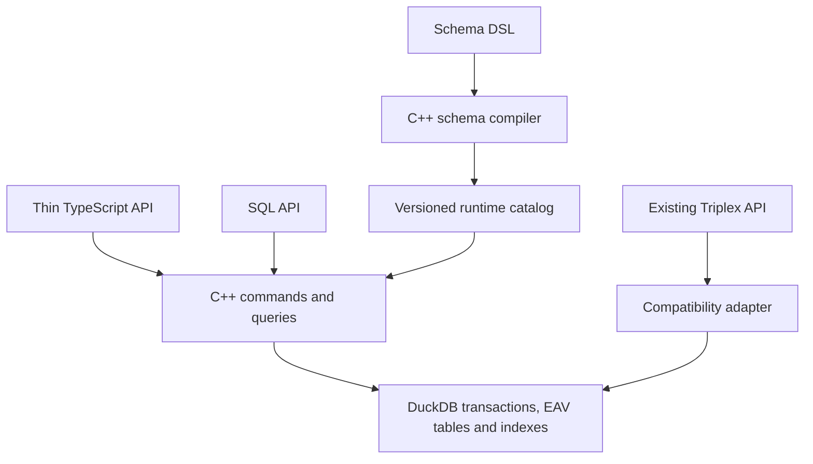

# Integrated temporal store

## Required architecture target

Contributor's direction is the governing target for the ten-goal implementation:

> Native C++ semantics, schemas defined through a DSL, and thin TypeScript/SQL
> APIs. The adapter is a bridge while that native engine is built. Schemas
> compile into runtime catalog data, so introducing a new entity type does not
> require rebuilding the extension.

The clarified scale target is a read-heavy temporal fact store for hundreds of
thousands to millions and many millions of retained events/facts, with fast
large-data queries and many concurrent readers. Write throughput is secondary;
write correctness, history and receipts remain required. Small-fixture gains are
regression evidence, not the scale goal. The current active-fact admission cap,
single serialized connection and one-thread configuration are experimental
profile limits. Scalable SQL-owned admission and independently owned concurrent
reader connections require further design and actual large-data/concurrency
evidence. See the [takeover handoff](../handoffs/mac-zero-context-takeover-20261105.md)
for the vision, current gaps and DuckDB deployment-model references.

The C++ engine owns schema parsing/validation, typed values, constraints, Datalog
planning/execution, temporal behavior and command semantics. It uses DuckDB for
physical storage, transaction execution and recovery. TypeScript provides typed
builders, Effect/lifecycle integration and value conversion; SQL provides a
second entry point to the same native semantics. Both interfaces must obtain the
same validation and query behavior from the engine.

The schema DSL compiles to versioned catalog descriptors with stable identities
for schemas, entity types, attributes, references and constraints. These are
persisted data read by the installed extension. User-schema changes and physical
catalog-format migrations are distinct operations. New entity types can be
registered at runtime; changing the extension's implementation or catalog format
may still require an extension upgrade. Schema versions used for commands and
historical reads must be explicit and preserved.

Logical definitions guide validation and query planning. Physical tables,
indexes and maintained projections are engine choices, backed by measurements.
The existing physical version-5 catalog is a foundation; it does not complete
the user-schema DSL/catalog work.

The Triplex compatibility adapter preserves the existing API and conformance
fixtures while behavior moves into C++. Its database rules should shrink as
native commands replace them. Python remains a build helper and independent
reference/test path. Future optimization should strengthen this native design.

The next implementation milestone is a complete native schema path:

1. Parse a bounded declarative schema DSL in C++ into a versioned definition.
2. Register that definition transactionally as runtime catalog data.
3. Apply its types and constraints through native commands, with thin SQL and
   TypeScript entry points.
4. Add another entity type, close/reopen the database and use it through both
   interfaces with the exact same extension binary/hash.
5. Verify matching acceptance/rejection and query results from both interfaces,
   atomic failure behavior, and preservation of prior schema/history meaning.

This milestone now works for the four-scalar complete-record profile; see
[native schema and commands](NATIVE-SCHEMA.md). C++ compiles and validates the
schema, generates atomic command SQL, binds versions to commands/history and
defines the temporal read cuts. A new entity type works after reopen with the
same extension binary. The existing Triplex write path does not enforce these
definitions yet.

The bridge retains the legacy API while native semantics replace it in bounded
slices. It shares the physical store; it does not yet delegate every write to the
new schema-bound command API. User schemas are data, rather than generated C++
types or separately compiled extensions. Physical layouts and projections remain
engine choices; this slice uses the shared typed EAV table.

## Native runtime and common catalog

The primary Triplex runtime uses the pinned native Node binding directly. There
is no child process or JSON framing in its import/request path. The C++ extension
embeds the version-5 physical catalog and exposes it through a DuckDB query
pragma; DuckDB executes the DDL in the caller's transaction. This avoids issuing
reentrant SQL from a scalar callback. The same extension now implements a bounded
native entity-schema DSL, immutable version registration, complete-record
validation, atomic schema-bound replacements and history reads. Full Triplex
business constraints, references and schema-aware query optimization remain open.

The new native command API uses a C++ query pragma to expand a single user
statement into a fixed sequence of transaction-local plans, checks and mutations.
DuckDB's pinned 2.0.0 engine executes the expansion atomically. Tests inject a
failure at the late assertion INSERT, after command headers and retractions,
and verify complete rollback in both run and stream paths. An explicit caller
transaction can also encompass the command. No scalar callback executes
reentrant SQL or casts an opaque context to internal C++ engine objects.

Each entity has stable schema-name/type ownership; each creator command records
an immutable schema version and hash. Full-record replacement closes all live
native assertions for that entity and appends the validated record. Historical
reads verify the original descriptor, command binding and scalar carrier. This
does not yet implement interval-local patches or global graph constraints.
Schema `ref(Type)` fields now constrain string IDs to stable native entity
identity in the same schema/type. Forward/self type declarations are compiled
in C++; commands enforce existing targets and first-write self-links atomically.
Historical reads require the target's durable first declaration no later than
the source command, under its original schema version. Target identity is
independent of property validity intervals; temporal foreign keys, deletion and
cascades remain future work. Reference metadata and first-declaration positions
are runtime catalog views; no entity-specific binary or TypeScript schema
semantics are introduced. See [reference contracts](NATIVE-SCHEMA.md#native-references).
Legacy assertions cannot be silently adopted/retracted by a native
command; an explicit migration API remains future work.

The native persisted-query API compiles programs and attribute scope in C++,
validates retained carriers and original native schema bindings in SQL, builds
one distinct active EAV snapshot, and selects proved SQL or bounded C++ evaluation
without a host fact list. Typed output uses decimal int64 and binary64 bits.
The query returns route metadata; native counters are actual, while SQL counters
are null. Native work/deadline polling rejects without partial results; SQL
selection/validation/output are outside that evaluator deadline. Derived-relation
joins, filters and larger aggregate-program SQL lowering remain open.

The optional owned query-control scope adds AbortSignal and a whole-query
timeout without replacing the native evaluator deadline. A hashed Node-API
addon reaches the extension's existing invocation registry through its public
control C ABI. A cancellation sets that invocation's atomic flag and interrupts
DuckDB. C++ polls native evaluation; the driver polls native monotonic status
during output conversion, then awaits execution/result cleanup and retires the
token. A queued abort cannot interrupt a prior invocation. The scope holds the
connection through terminal cleanup. No opaque client-context casts, schema
semantics, facts or results enter the bridge. The loaded image is pinned, with
one loader reference and at most 1024 live controls. These are cooperative
controls, not physical containment. See [the contracts](NATIVE-SCHEMA.md#cancellation-and-whole-query-timeout).

C++ can compile the controlled query to parameterized read SQL through
td_query_store_sql_v1. The host transports the template and binds a fresh
invocation token; the same bounded prepared LRU can then reuse structural SQL
without retaining data or token values. Oversized templates return NULL and
retain the original pragma path. Retired tokens reject at execution, and tests
refresh data, rollback and original schema meaning through the same template.
This transport change does not add a host compiler or weaken the native proof.

Driver cleanup failures are collected independently and fence the port before
pending ownership clears. Primary execution errors are preserved, cancellation
cannot replace cleanup uncertainty, and explicit close attempts remaining
resources even after earlier release failures. Failed releases are retained for
close-only cleanup; business operations never resume on that port. Real SDK
fault-injection tests exercise these paths separately from normal recovery.

The first C++ SQL lowering admits exactly one ordinary answer rule over one EAV
atom. It rejects filters, negation, aggregates, ground facts and extra rules from
this route, preserving native fallback for them. Constants and repeated
variables compare all five typed slots, with UTF-8 strings as BLOBs. Projection
uses DISTINCT; sorting uses tag followed by its active typed slot.

Let n be the full relevant distinct active EAV count, before literal matching.
Fresh SQL statistics prove conservative bounds of 2n facts, two rounds and 2n+1
work units. Dictionary values are bounded by 3n plus every constant occurrence
and 32 spare entries. Dictionary bytes add the full E/A/string-value byte sum,
constant-string bytes and the compiler model's per-entry charge. Output uses
the model's typed row size plus each head term's maximum text bytes. A separate
wire bound adds 256 bytes per cell, 128 per row and up to six bytes per text byte.
All bounds must fit current budgets and the native model; failed proof runs the
native evaluator rather than rejecting a query that it might admit. No caller
supplies statistics or a proof. These are logical bounds, not heap containment.

C++ also lowers one answer rule over two to four positive EAV atoms. Fresh
per-atom cardinalities and key frequencies bound every subset's satisfying
bindings separately from native indexed candidates, including rejected rows.
One grouping specializes independent attributes of the same entity. Subset
row/cell/carrier limits and native fact/work/dictionary/output limits must all
hold. SQL inputs are materialized behind admission before joins run; an
unproved Cartesian product therefore falls back without constructing that
product. See [the source-coupled join proof](NATIVE-JOIN-PROOF.md).

C++ also lowers direct count and one single-atom projection followed by complete
source count. DISTINCT source tuples and five-slot grouping preserve native set
identity; empty global count yields zero. Fresh source/group counts prove native
fact/work/dictionary/output admission. A worst-case logical source gate precedes
projection and grouping, including wide repeated constants. Failed proof uses
the bounded native evaluator. SQL-selected execution gates native input-list
collection off. See [the count proof and paired results](NATIVE-COUNT-PROOF.md).

The same complete-source profile now admits min/max and sum_i64. Fresh projected
measure statistics prove homogeneous non-boolean extrema domains or int64 sum
inputs. BLOB extrema retain byte order. HUGEINT accumulation and TRY_CAST prove
final sum range without prefix overflow; any unproved domain/range selects the
unchanged native evaluator, preserving its canonical budget/tag/range errors.
Internal groups include the empty global group before extrema output filtering;
non-count work bounds include both source scans and both group passes. Extrema
measure bytes and the extra source-count column enter logical carrier gates.
See [the source-coupled aggregate proof](NATIVE-AGGREGATE-PROOF.md).

The thin API asks `td_prefer_native_v1` for a cost-only preference over the
current retained-row ledger: below 16384 rows, use the smaller native query
plan; otherwise try proved SQL. This empirical heuristic includes historical
and unrelated rows and can be suboptimal. It does not authorize execution or
replace fresh admission. A concurrent change can affect the hint's usefulness,
while the actual query still reads and validates its own coherent cut.
`forceNative: true` selects native explicitly; `false` tries SQL with fallback.
No route decision, facts or output is cached by this dispatch.

Schema-fact checks now use the native compiled definition directly, avoiding a
JSON attribute join per history check. Every descriptor/entity/attribute/tag is
still checked. After all input aliases are normalized, callback-local borrowed
string views avoid copying DSL/descriptor bytes. The same immutable input cell
can reuse its structural comparison; a changed DSL invalidates the descriptor
check even if its input pointer is unchanged. No view escapes the callback, and
every fact/entity/attribute/tag check still runs. No row outcome is retained.

The public factory creates a fresh owned instance and takes no incoming
connection or raw SQL. SQL catalog counts diagnose visible attachments only:
DuckDB 2.0.0 hides HIDDEN attachments even from PRAGMA database_list. Raw SQL
entry points require an equivalently owned session; they do not prove general
host-supplied attachment admission. The C API v2 currently offers no unfiltered
callback-context attachment enumeration. Earlier comments claiming the SQL
listing included hidden attachments were corrected after a real-engine probe.

The common `main.assertions`, `main.commands`, `main.clock` and usage ledger
are authoritative. Triplex's previous tables are views over these relations.
The canonical carrier preserves exact scalar types plus Triplex references,
datetime, JSON and blob metadata. Native scalar evaluation remains four-tag;
only relevant attributes enter its input, and relevant unsupported tags fail.
No coercion turns references into strings or rounds an int64 into a JS number.

The Node transport reads one result chunk at a time and releases the result on
success, rejection and interruption. Its integer output normalization uses SQL
type metadata, so DOUBLE 1 and INTEGER 1 remain different transport types. A
bounded trace retains at most 256 entries. Logical admission is not a promise
that all DuckDB/native allocations are physically contained.

The native SELECT/read-only-query-pragma LRU retains at most 32 statements and
256 KiB of SQL text.
Parameters are explicitly typed (BIGINT versus DOUBLE), rebound for each call
and cleared after the result closes. Failed statements are removed. Tests cover
changed parameters, committed updates, rollback, catalog rebinding after ALTER,
eviction and close. Neither result rows nor a transaction cut are cached.

The native write path converts public rows to owned canonical append plans.
Those plans enter the same transaction-owner queue as SQL statements, then
become typed DuckDB data chunks and are flushed through an appender. Chunks
contain at most 2048 rows, split at a target of 8 MiB logical data, and preserve
the canonical UTF-8 BLOB/boolean/int64/DOUBLE carriers. Usage updates occur only
after an acknowledged append, inside the same transaction as receipts and the
clock. SQL VALUES remains the reference fallback for ports without appending.

A failed append is cleared and closed before rollback, with no retry. Cleanup
failure fences the connection. Backend admission errors after an earlier chunk
also invalidate the owner, even if the caller catches them; they cannot commit
a partial batch. Tests inject a second-chunk constraint/admission failure and
three abrupt native-process exits. Reopen verifies all-or-nothing rows, usage,
receipt and clock, followed by healthy writes. Appender flush is synchronous;
no hard latency or full native-allocation accounting claim follows from this.

Python-to-Node-to-Python tests exercise one sequential file, clock, fractional
validity, corrections, references and representation rejection. This is not a
claim of identical command-receipt/journal semantics or cross-process concurrent
writes. The native opener accepts new/version-5 catalogs; earlier supported
versions migrate transactionally through the reference API.

## Scalar reference API

The public Python store owns its DuckDB connection, schema, transactions and
commit-position clock. Callers submit immutable typed assertions/retractions
under a command ID. A committed receipt binds that ID to the exact request;
retries return the receipt or reject different content. Corrections close an
assertion's recorded interval and append replacement assertions atomically.
Valid and recorded intervals are half-open, using signed integer ticks.

Reads pin one transaction, commit position and valid cut. Retained assertions
cross the compiler boundary as validated `Fact` values. The genuine native v2
compiler supplies IR2; the completed-aggregate SQL compiler selects a proven
acyclic route, otherwise the native stratified evaluator executes. Typed
results and route explanations are immutable public values. No caller SQL,
connection, catalog attachments or extension paths cross the public API.

Boundaries: `temporal_store/store.py` owns persistence and the public workflow;
`temporal_store/compiler/` owns typed planning and result conversion;
`native/src/` owns grammar, stratification and bounded evaluation. The native
kernel and SQL compiler originate in the exact published checkpoints listed
in SOURCE-PROVENANCE.json. The new native build is version-pinned to DuckDB
2.0.0 C API v2 and supports macOS with strict floating-point controls.

Failures before commit roll back the whole command. An unknown commit outcome
must be resolved by reopening and reading its receipt, never by replaying
individual statements. Known schema versions migrate transactionally; unknown
versions fail before writes. Native
work/fact/round limits and bounded retained-history admission are logical
limits; they do not imply physical memory containment. Cancellation must not
promise full physical containment. The controlled callback now owns an atomic
cancellation/deadline token, with actual loop termination/reuse tests; this does
not claim a hard wall-clock latency bound. Source-only historical claims remain
source-only.

Integration order: native build and real typed smoke; owned public commands,
corrections, receipts and reads; SQL/native and temporal regressions; recovery
faults and migrations; reuse/history and exact Triplex conformance. Each stage
records executed evidence and remaining limits. No historical worker run or
uncertain publication is retried by this package.

## Relational admission and shared-store continuation

The next read path keeps retained history in DuckDB. A transaction-local
statistics provider validates the complete persisted scalar carrier, then
returns set cardinality and typed domains for the base snapshot and each
compiler-owned EAV atom. The existing conservative budget proof consumes these
statistics through an explicit immutable contract. SQL execution continues to
read the same persisted relation and cut. Unsupported plans fetch only the
already-validated active snapshot for bounded native execution. No result,
permission, snapshot statistics or live database handle enters the IR cache.

A versioned usage ledger accounts for retained row/payload admission atomically
with commands, replacing repeated history scans on writes. Retained storage and
native invocation limits are separate: growing history must not construct an
unbounded Python list. Exact f64 persisted validation uses an inventory-free
native bit codec, retaining int64/f64 distinction and subnormal identity.

Failure contracts: invalid inactive rows fail before route selection; a
statistics/budget/query error rolls back the read; a native admission failure
returns no partial result. SQL statistics are scoped to the same transaction
as execution and never reused after a command. New large-history fixtures must
check SQL/native/raw-input equality, corrections, fresh-process reopen and
resource-limit failure before the retained-history profile is expanded.

Shared-schema version 5 now follows this read-path change. Its storage contract
preserves native exact integers and tagged references independently of the
Triplex number/string projection; representability errors are explicit. The
cross-API fixtures cover shared persistence, not a full common semantic API.

## Native performance iteration

Known-fact insertion now performs one hash insertion on the common path instead
of a lookup followed by another hash insertion. A failed admission terminates
the invocation; its partially built relation is never reused. Global aggregate
evaluation uses its known single group directly instead of hashing an empty
group key for each row. Work charging, polling, canonical error priority and
empty-group behavior remain unchanged. Alternating before/after measurements
check complete answers for count, grouped count, sum and join; full public-path
measurements are kept separately so kernel gains are not presented as total
database speedups.

The Python reference/test API now creates invocation controls inside its owned
read transaction and closes them before COMMIT/ROLLBACK. Closing retires listeners
and native control and joins timer delivery, so a late read deadline cannot
interrupt transaction cleanup and spuriously fence healthy reuse. A final query
guard checks delivery before retirement. A deterministic late-notification test
wraps the real connection cleanup seam and fails against the previous read
methods, while the corrected point/timeline paths acknowledge cleanup without
late interrupts. Unknown cleanup outcomes still fence; no command is replayed.
